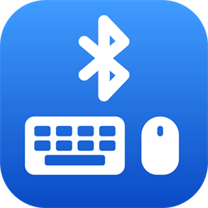
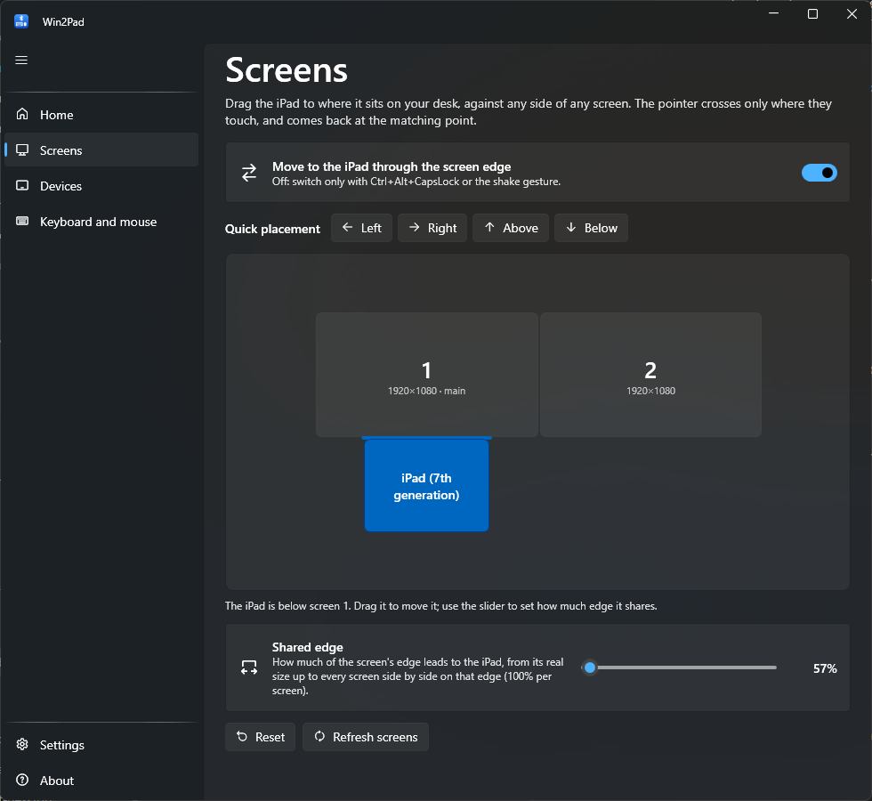
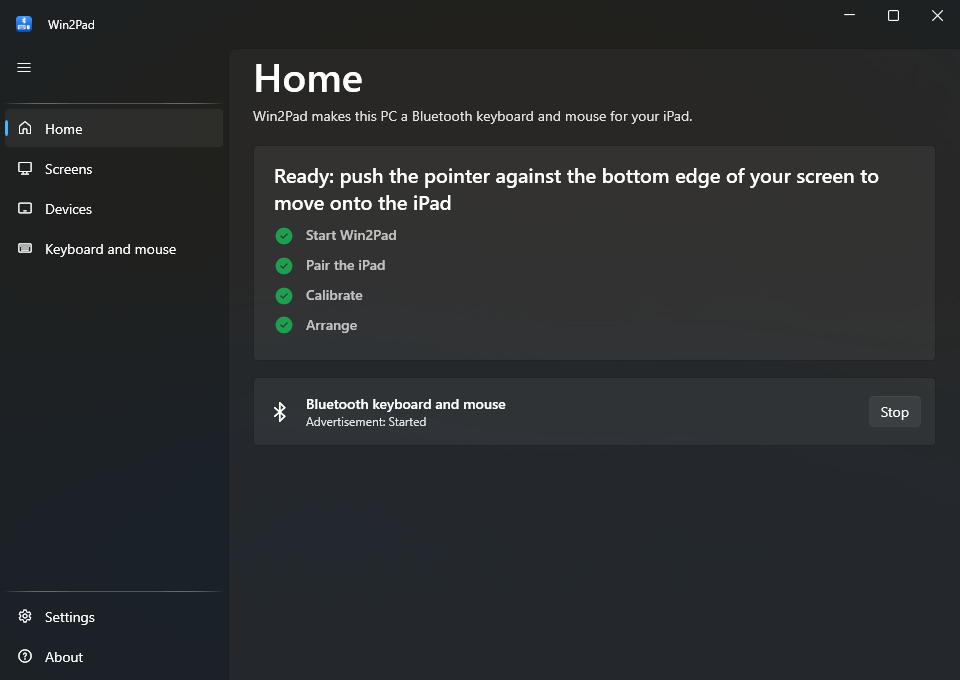
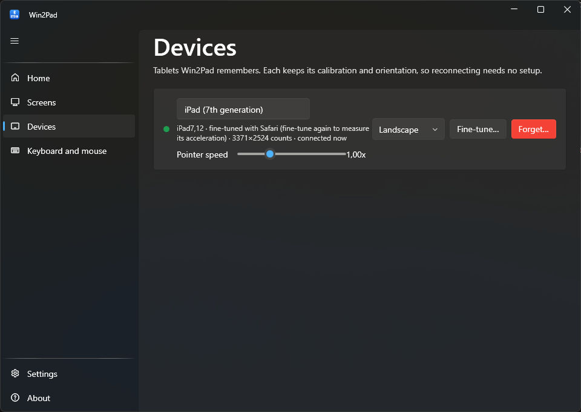
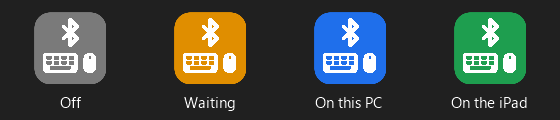

  

<h1 align="center">Win2Pad</h1>

  <strong>Usa el teclado y el ratón de tu PC con Windows en tu iPad.</strong> 
  Lleva el puntero más allá del borde de la pantalla y sigue en el iPad, como hace Universal Control entre un Mac y un iPad.

  
  
  

  <a href="README.md">English</a> · Español

  

Win2Pad es solo software. El Bluetooth de tu propio PC se presenta ante el iPad como un teclado
y un ratón Bluetooth normales, así que **no hay que instalar nada en el iPad** ni comprar
ningún accesorio.

> La aplicación está en inglés; las capturas y los nombres de los menús de esta guía están
> tal cual aparecen en ella.

## Qué hace

- **Pasa por el borde de la pantalla** al iPad y vuelve a la misma altura. Coloca el iPad en
  cualquier lado de cualquier monitor, como en la configuración de pantallas de Windows, y elige
  cuánto borde lleva hasta él.
- **Se configura solo.** Lee el modelo del iPad por Bluetooth y se calibra con el tamaño de su
  pantalla. Un ajuste fino opcional con Safari mide tu iPad con exactitud, aceleración del
  puntero incluida.
- **Recuerda cada iPad** con su calibración, orientación y velocidad del puntero.
- **Sabes siempre dónde está el control**: el icono de la bandeja, y una etiqueta flotante
  opcional, cambian de color.
- **Cualquier distribución de teclado.** Las teclas se envían por posición, como un teclado
  Bluetooth de verdad: QWERTY, QWERTZ, AZERTY, Dvorak, japonés o brasileño, con la `ñ`, los acentos y AltGr.
- **Se actualiza solo** y puede arrancar con Windows.

## Requisitos

- Windows 10 versión 2004 o posterior, o Windows 11.
- Un adaptador Bluetooth que admita el modo *LE periférico*. La mayoría de los integrados de
  los últimos años lo admiten; la página Home de Win2Pad te avisa si el tuyo no.
- Un iPad con iPadOS 13.4 o posterior (la primera versión con soporte de puntero).

Nada más: el instalador lleva su propia copia de .NET, así que no hay que instalar ningún runtime.

## Instalación

1. Descarga **`Win2Pad-win-Setup.exe`** de la [última versión](https://github.com/MalvioApps/Win2Pad/releases/latest).
2. Ejecútalo. Win2Pad se instala solo para tu usuario (sin permisos de administrador) y se abre.
3. Windows puede decir que el instalador es de un editor desconocido, porque todavía no está
   firmado. Pulsa **Más información → Ejecutar de todas formas**.

A partir de ahí, Win2Pad se actualiza solo. Para desinstalarlo, usa *Configuración → Aplicaciones* de Windows.

## Primeros pasos

La página **Home** de Win2Pad tiene una lista que se va marcando sola:

  

1. **Abre Win2Pad.** Tu PC queda disponible como teclado y ratón Bluetooth.
2. **Empareja el iPad, una sola vez.** En el iPad, abre *Ajustes → Bluetooth*, busca tu PC en
   *Otros dispositivos* y tócalo. A partir de ahí se reconecta solo.
3. **La calibración se hace sola**: Win2Pad lee el modelo del iPad y conoce su pantalla.
4. **Coloca el iPad** en **Screens**, donde lo tienes en la mesa (ver más abajo).
5. **Empuja el puntero** contra ese borde de la pantalla: sigue en el iPad. Para volver, empuja
   más allá del borde del iPad que da al PC.

Configura también en el iPad la distribución de tu teclado: *Ajustes → General → Teclado →
Teclado físico* (por ejemplo, Español ISO).

## Cómo se usa

### Screens (pantallas)

Arrastra el iPad a cualquier lado de cualquier monitor. Se pega a ese lado y a posiciones útiles
a lo largo de él (alineado, centrado, entre dos pantallas), y una línea de color marca por dónde
cruza el puntero. **Quick placement** lo centra en un lado de la pantalla principal con un clic.
El deslizador **Shared edge** decide cuánto borde lleva al iPad, desde su tamaño real hasta todas
las pantallas que estén juntas en ese lado (100% por pantalla).

### Devices (dispositivos)

  

Cada iPad que Win2Pad ha visto, con:

- **Nombre**: haz clic para cambiarlo.
- **Orientación**: el Bluetooth no sabe cómo sujetas el iPad, así que díselo aquí o desde el
  menú de la bandeja.
- **Velocidad del puntero** en ese iPad.
- **Fine-tune…**: calibración precisa con Safari (ver abajo).
- **Forget…**: lo olvida y, si quieres, quita también su emparejamiento Bluetooth en Windows.

### Ajuste fino con Safari (opcional)

Úsalo si el puntero vuelve a una altura que no es, si cambiaste la velocidad del puntero en los
ajustes del iPad, o para la máxima precisión. Tarda unos 20 segundos:

1. En **Devices**, pulsa **Fine-tune…** junto al iPad. Aparece un código QR.
2. En el iPad, escanéalo con la Cámara y abre la página en Safari. El iPad y el PC tienen que
   estar en la misma Wi-Fi. Si Windows pregunta por el acceso a la red, permítelo en redes
   privadas.
3. Deja la página delante, no toques el iPad y pulsa **Start**. Win2Pad mueve el puntero solo y
   mide la pantalla y la aceleración del puntero.

### ¿Dónde está el control?

  
  &nbsp;&nbsp;
  

El icono de la bandeja está **gris** con Win2Pad apagado, **ámbar** mientras espera al iPad,
**azul** con el iPad conectado y tú usando el PC, y **verde** mientras controlas el iPad. El
**indicador flotante** opcional (*Settings → Floating indicator*) muestra lo mismo en pantalla;
arrástralo donde quieras y ocúltalo con clic derecho.

### Atajos

| Atajo | Qué hace |
|---|---|
| `Ctrl` + `Alt` + `Bloq Mayús` (o `Ctrl` + `D` + `C`) | Cambia entre el PC y el iPad sin usar el borde |
| `Ctrl` + `Alt` + `Q` | Vuelve al PC, haga lo que haga el iPad |
| Agitar el ratón | Cambia, si lo activas en *Keyboard and mouse* |

## Solución de problemas

| Problema | Qué hacer |
|---|---|
| El iPad dice que está conectado pero no se mueve nada | En el iPad, *Ajustes → Bluetooth → (tu PC) → Omitir dispositivo*, y vuelve a emparejar con Win2Pad abierto. |
| Los símbolos o la `ñ` salen mal | Pon en el iPad la misma distribución que tu teclado: *Ajustes → General → Teclado → Teclado físico*. Win2Pad envía las teclas por posición, así que vale cualquier distribución (QWERTY, QWERTZ, AZERTY, Dvorak, JIS...). |
| La tecla a la izquierda del 1 y la de la izquierda de la Z salen cambiadas | Activa *Swap the two ISO keys* en **Keyboard and mouse**. |
| Cuesta mucho volver, o se abren las notificaciones | Comprueba que **Screens** coincide con tu mesa y haz **Fine-tune…** del iPad en **Devices**. |
| El puntero vuelve a una altura que no es | Haz **Fine-tune…** del iPad en **Devices**. |
| Entra al iPad cuando no quieres | Desactiva *Move to the iPad through the screen edge* en **Screens** y usa el atajo. |
| La página Home dice que el Bluetooth no puede anunciarse | Tu adaptador no admite el modo LE periférico; un adaptador USB Bluetooth 5 pequeño suele servir. |

¿Sigues atascado? **About → Report a problem** abre un informe de error con tu versión, Windows y
modelo de iPad ya rellenos. **About → Diagnostics** muestra la conexión Bluetooth en detalle y
tiene un botón **Copy log** para pegar el registro en el informe.

## Privacidad

Win2Pad no tiene telemetría ni cuentas. Solo se conecta a internet para buscar actualizaciones
en GitHub (puedes desactivarlo en *Settings*), y la página del ajuste fino solo se sirve en tu
red local mientras su ventana está abierta. Los ajustes se guardan en
`%LOCALAPPDATA%\MalvioApps\Win2Pad`.

## Cómo funciona

Win2Pad usa el Bluetooth de Windows para publicar un teclado y un ratón Bluetooth LE estándar
(HID over GATT). Mientras el iPad está activo, captura el teclado y el ratón con *hooks* de bajo
nivel y los envía como informes HID en lugar de dejar que los use Windows. Un ratón Bluetooth
solo envía movimientos relativos, así que Win2Pad estima dónde está el puntero del iPad con la
calibración y la aceleración medida, para saber cuándo empujas más allá de su borde.

## Compilar, publicar y créditos

Las instrucciones para compilar y publicar versiones están en el [README en inglés](README.md#building).

Win2Pad parte de [windows-ble-hid](https://github.com/abhishek-raj/windows-ble-hid) de Abhishek
Raj (MIT) y toma el diseño del cambio por borde de [BlueShare](https://github.com/giagar5/BlueShare)
(Apache-2.0). Ver [NOTICE.md](NOTICE.md).

iPad e iPadOS son marcas de Apple Inc. Win2Pad no está afiliado a Apple ni a Microsoft.

## Licencia

[MIT](LICENSE) © MalvioApps
