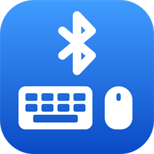
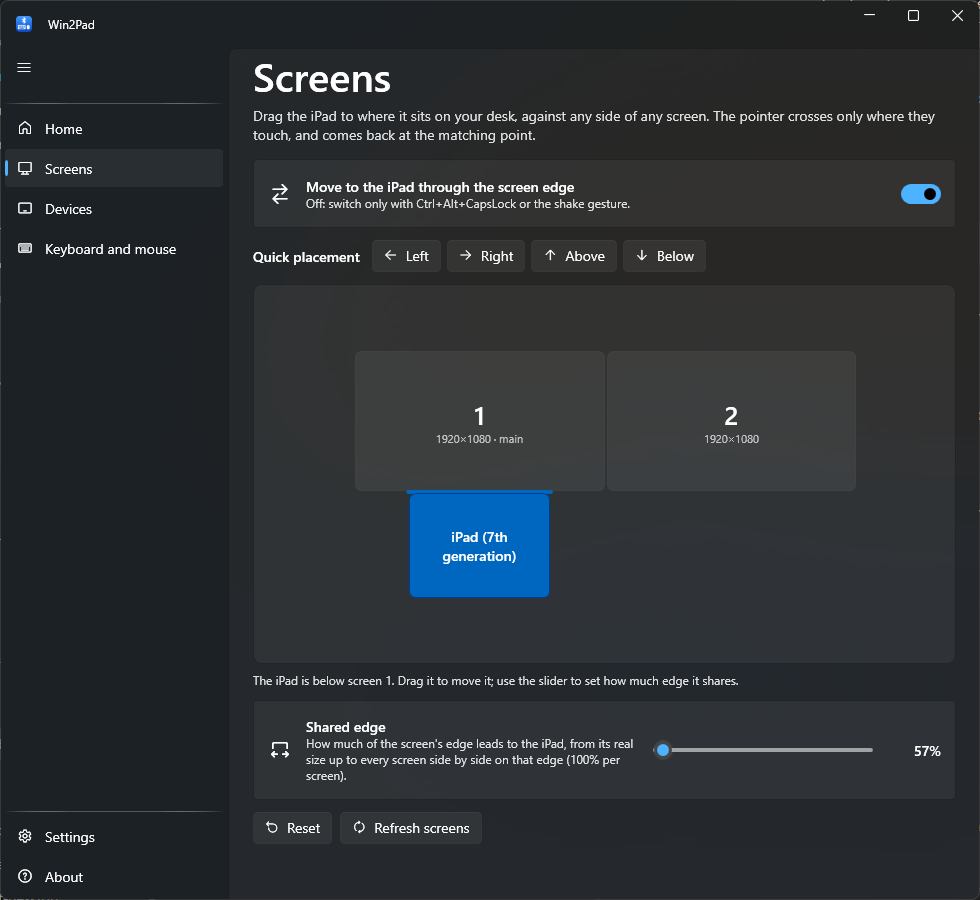
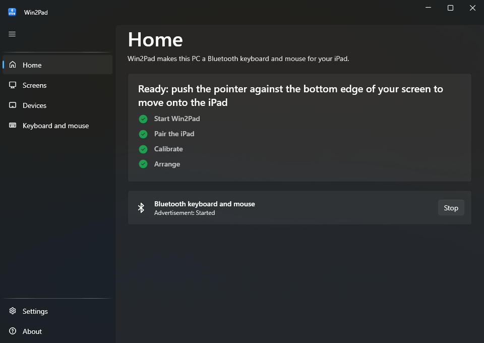
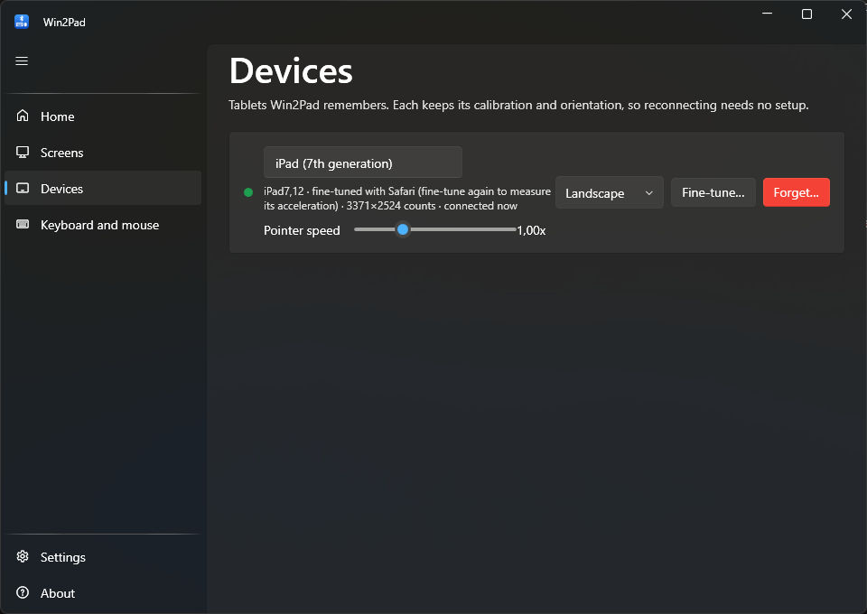
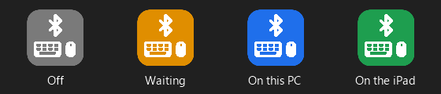

<p align="center">
  
</p>

<h1 align="center">Win2Pad</h1>

<p align="center">
  <strong>Use your Windows keyboard and mouse on your iPad.</strong><br>
  Push the pointer past the edge of your screen and it carries on onto the iPad, like Universal Control does between a Mac and an iPad.
</p>

<p align="center">
  <a href="https://github.com/MalvioApps/Win2Pad/releases/latest"></a>
  <a href="https://github.com/MalvioApps/Win2Pad/actions/workflows/ci.yml"></a>
  <a href="LICENSE"></a>
</p>

<p align="center">
  English · <a href="README.es.md">Español</a>
</p>

<p align="center">
  
</p>

Win2Pad is software only. Your PC's own Bluetooth presents itself to the iPad as an ordinary
Bluetooth keyboard and mouse, so there is **nothing to install on the iPad** and no extra
hardware to buy.

## Features

- **Move across the screen edge** onto the iPad and back, at the matching height. Place the iPad
  against any side of any monitor, like Windows' display settings, and choose how much of the
  edge leads to it.
- **Sets itself up.** Win2Pad reads the iPad's model over Bluetooth and calibrates from its
  screen size. An optional fine-tune with Safari measures your iPad exactly, pointer
  acceleration included.
- **Remembers each iPad** with its own calibration, orientation and pointer speed.
- **Always know where your input is**: the tray icon, and an optional floating label, change
  colour.
- **Any keyboard layout.** Keys are sent by position, like a real Bluetooth keyboard: QWERTY,
  QWERTZ, AZERTY, Dvorak, Japanese and Brazilian keyboards all work, AltGr included.
- **Updates itself** and can start with Windows.

See what is coming next in the [roadmap](ROADMAP.md).

## Requirements

- Windows 10 version 2004 or later, or Windows 11.
- A Bluetooth adapter that supports the *LE peripheral* role. Most built-in adapters of the
  last few years do; Win2Pad tells you on its Home page if yours does not.
- An iPad with iPadOS 13.4 or later (the first version with pointer support).

Nothing else: the installer carries its own copy of .NET, so there is no runtime to install.

## Install

1. Download **`Win2Pad-win-Setup.exe`** from the [latest release](https://github.com/MalvioApps/Win2Pad/releases/latest).
2. Run it. Win2Pad installs for your user only (no administrator rights needed) and opens.
3. Windows may say the installer is from an unknown publisher, because it is not signed yet.
   Choose **More info → Run anyway**.

Win2Pad updates itself from then on. To uninstall it, use *Settings → Apps* in Windows.

## Getting started

Win2Pad's **Home** page has a checklist that ticks itself as you go:

<p align="center">
  
</p>

1. **Start Win2Pad.** It makes your PC available as a Bluetooth keyboard and mouse.
2. **Pair the iPad, once.** On the iPad, open *Settings → Bluetooth*, find your PC under
   *Other Devices* and tap it. From then on it reconnects by itself.
3. **Calibration happens by itself**: Win2Pad reads the iPad's model and knows its screen.
4. **Place the iPad** in **Screens**, where it is on your desk (see below).
5. **Push the pointer** against that edge of your screen: it continues on the iPad. Push past
   the iPad's edge facing your PC to come back.

Also set your keyboard's layout on the iPad: *Settings → General → Keyboard → Hardware Keyboard*.

## Using Win2Pad

### Screens

Drag the iPad to any side of any monitor. It snaps to the side and to useful positions along it
(flush, centred, between two screens), and a coloured line shows where the pointer crosses.
**Quick placement** puts it centred against a side of the main screen in one click. The
**Shared edge** slider sets how much of the edge leads to the iPad, from its real size up to
every screen side by side (100% per screen).

### Devices

<p align="center">
  
</p>

Every iPad Win2Pad has seen, with:

- **Name**: click it to rename.
- **Orientation**: Bluetooth cannot tell how you hold the iPad, so tell Win2Pad here or from
  the tray menu.
- **Pointer speed**: how fast the pointer moves on that iPad.
- **Fine-tune…**: precise calibration with Safari (see below).
- **Forget…**: removes it, and optionally its Bluetooth pairing in Windows.

### Fine-tune with Safari (optional)

Use it if the pointer comes back at the wrong height, if you changed the pointer speed in the
iPad's settings, or for the best precision. It takes about 20 seconds:

1. In **Devices**, press **Fine-tune…** next to the iPad. A QR code appears.
2. On the iPad, scan it with the Camera and open the page in Safari. The iPad and the PC must
   be on the same Wi-Fi. If Windows asks about network access, allow it on private networks.
3. Leave the page in front, don't touch the iPad, and press **Start**. Win2Pad moves the
   pointer by itself and measures the screen and the pointer acceleration.

### Where is my input?

<p align="center">
  
  &nbsp;&nbsp;
  
</p>

The tray icon is **grey** when Win2Pad is off, **amber** while it waits for the iPad, **blue**
when the iPad is connected and you are using the PC, and **green** while you control the iPad.
The optional **floating indicator** (*Settings → Floating indicator*) shows the same on screen;
drag it anywhere, right-click to hide it.

### Shortcuts

| Shortcut | What it does |
|---|---|
| `Ctrl` + `Alt` + `CapsLock` (or `Ctrl` + `D` + `C`) | Switch between the PC and the iPad without using the edge |
| `Ctrl` + `Alt` + `Q` | Back to the PC, whatever the iPad is doing |
| Shake the mouse | Switch, if enabled in *Keyboard and mouse* |

## Troubleshooting

| Problem | What to do |
|---|---|
| The iPad says it is connected but nothing moves | On the iPad, *Settings → Bluetooth → (your PC) → Forget This Device*, then pair again while Win2Pad is running. |
| Symbols or letters come out wrong | Set the same layout as your keyboard on the iPad: *Settings → General → Keyboard → Hardware Keyboard*. Win2Pad sends keys by position, so any layout works (QWERTY, QWERTZ, AZERTY, Dvorak, JIS...). |
| The key left of 1 and the key left of Z are swapped | Turn on *Swap the two ISO keys* in **Keyboard and mouse**. |
| Coming back takes too much pushing, or notifications open | Check that **Screens** matches your desk, then **Fine-tune…** the iPad in **Devices**. |
| The pointer comes back at the wrong height | **Fine-tune…** the iPad in **Devices**. |
| It enters the iPad when you don't want it to | Turn off *Move to the iPad through the screen edge* in **Screens** and use the shortcut instead. |
| The Home page says Bluetooth cannot advertise | Your adapter does not support the LE peripheral role; a small USB Bluetooth 5 adapter usually does. |

Still stuck? **About → Report a problem** opens a bug report with your version, Windows and iPad
model already filled in. **About → Diagnostics** shows the Bluetooth connection in detail and has
a **Copy log** button to paste the log into the report.

## Privacy

Win2Pad has no telemetry and no account. It goes online only to check GitHub for updates (you
can turn that off in *Settings*), and the fine-tune page is served on your local network only
while its window is open. Settings live in `%LOCALAPPDATA%\MalvioApps\Win2Pad`.

## How it works

Win2Pad uses the Windows Bluetooth stack to publish a standard Bluetooth LE keyboard and mouse
(HID over GATT). While the iPad is active, it captures your keyboard and mouse with low-level
hooks and sends them as HID reports instead of letting Windows handle them. A Bluetooth mouse
only sends relative movement, so Win2Pad estimates where the iPad's pointer is from the
calibration and the iPad's measured acceleration, to know when you push past its edge.

## Building

```
dotnet test Win2Pad.sln
dotnet run --project src/Win2Pad.App
```

Needs the .NET 10 SDK (see `global.json`). `--page screens` (or `home`,
`devices`, `keyboard`, `settings`, `about`) opens the app on that page.

## Releasing

Write what changed in `docs/release-notes/<version>.md`, then push a version tag. The `release`
workflow runs the tests, builds the installer with
[Velopack](https://velopack.io) and publishes the GitHub release that installed copies update
from:

```
git tag v0.1.0
git push origin v0.1.0
```

## Credits

Win2Pad started from [windows-ble-hid](https://github.com/abhishek-raj/windows-ble-hid) by
Abhishek Raj (MIT) and takes its edge-switching design from
[BlueShare](https://github.com/giagar5/BlueShare) (Apache-2.0). See [NOTICE.md](NOTICE.md).

iPad and iPadOS are trademarks of Apple Inc. Win2Pad is not affiliated with Apple or Microsoft.

## License

[MIT](LICENSE) © MalvioApps
